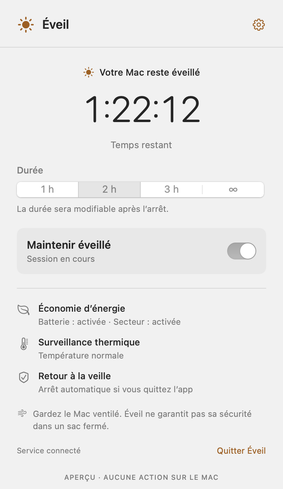
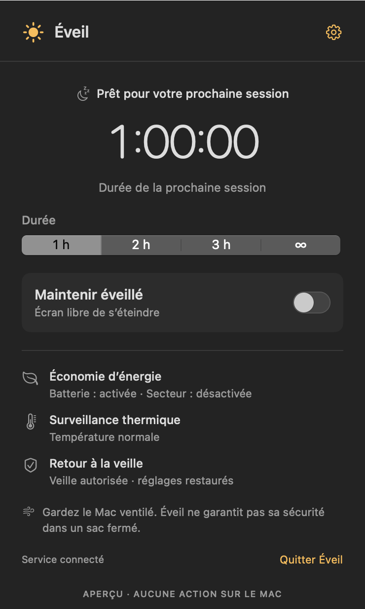

# Eveil

**Laissez votre Mac travailler. Choisissez quand il peut se remettre en veille.**

Une tâche IA tourne encore, un téléchargement n’est pas terminé ou un traitement doit continuer pendant votre absence ? Eveil maintient votre Mac éveillé pour la durée choisie, sans commande Terminal ni modification manuelle des réglages système.

Tout se pilote depuis une icône soleil dans la barre des menus : **1 heure, 2 heures, 3 heures ou une durée illimitée**. Un compteur indique le temps restant et un interrupteur permet d’arrêter à tout moment.

**Mac Apple Silicon · macOS 14 ou ultérieur · Interface en français**

[Voir les releases](https://github.com/emieuxcharles/Eveil-MacOS/releases) · [Signaler un problème](https://github.com/emieuxcharles/Eveil-MacOS/issues)

## Un coup d’œil suffit

<table>
  <tr>
    <th>Une session en cours</th>
    <th>Prêt pour la prochaine tâche</th>
  </tr>
  <tr>
    <td></td>
    <td></td>
  </tr>
</table>

*Captures des vues natives de l’application, en mode démonstration. Les durées et les états affichés sont des exemples.*

## À quoi ça sert ?

Eveil est utile lorsque vous voulez laisser une tâche se poursuivre sans que la mise en veille du Mac ne l’interrompe :

- **Une tâche IA** : laisser un agent ou un traitement local poursuivre son travail.
- **Un transfert de fichiers** : attendre la fin d’un téléchargement ou d’un envoi volumineux.
- **Un traitement long** : garder le Mac disponible pendant une compilation, un export ou un calcul.

Eveil agit sur la veille du Mac. L’écran peut s’éteindre pendant la session. L’app ne maintient pas à elle seule une connexion Internet et ne relance pas une tâche interrompue par son propre logiciel.

## Ce qui se passe pendant une session

| Votre action | Ce que fait Eveil |
| --- | --- |
| Vous choisissez une durée et activez l’interrupteur | Le Mac reste éveillé et le compte à rebours démarre après confirmation du service. |
| Vous fermez le panneau | La session continue dans la barre des menus. |
| La durée expire, vous désactivez l’interrupteur ou vous quittez l’app | La veille est rétablie et les réglages d’économie d’énergie précédents sont restaurés. |
| Vous choisissez une durée illimitée | La session continue jusqu’à son arrêt ; les protections restent actives. |

Pendant une session, Eveil active temporairement le **mode économie d’énergie**. Si macOS signale un **état thermique sérieux ou critique**, Eveil arrête la session et demande la mise en veille. Une session arrêtée ne reprend pas automatiquement au réveil.

> **Gardez le Mac ventilé.** L’économie d’énergie et la surveillance thermique ne rendent pas son utilisation dans un sac fermé sûre.

## Commencer en trois étapes

1. **Installez Eveil.** Téléchargez l’archive depuis [Releases](https://github.com/emieuxcharles/Eveil-MacOS/releases), décompressez-la et ouvrez `Eveil.app`. Choisissez **Installer dans Applications** si proposé.
2. **Autorisez le service.** Suivez les indications de l’app pour l’activer et, si macOS le demande, autorisez Eveil en arrière-plan dans les Réglages Système. Revenez dans l’app pour vérifier l’autorisation.
3. **Lancez votre session.** Cliquez sur le soleil, choisissez une durée et activez **Maintenir éveillé**.

Le service permet à Eveil de modifier les réglages de veille et de les restaurer. L’application affiche la confirmation du service avant de considérer la session comme active.

## Besoin d’aide ou envie de désinstaller ?

En cas de problème, ouvrez les réglages d’Eveil et choisissez **Exporter le diagnostic…**. Vous pouvez ensuite [ouvrir une issue](https://github.com/emieuxcharles/Eveil-MacOS/issues) en décrivant le problème.

Pour désinstaller, choisissez **Retirer le service…**, attendez la confirmation, quittez Eveil puis placez l’application dans la Corbeille.

<details>
<summary><strong>Pour les développeurs : compilation et releases</strong></summary>

## Développement

Avec Xcode et ses outils de ligne de commande :

```sh
swift test
swift build -c release
```

Pour créer `dist/Eveil.app`, signée avec votre certificat Developer ID :

```sh
EVEIL2_SIGN_IDENTITY="EMPREINTE_DU_CERTIFICAT" ./scripts/build.sh
```

L’application et son service exigent une signature de l’équipe Apple configurée dans `Sources/EveilIPC/Protocol.swift`.

## Releases automatiques

- **Push sur `main` ou pull request vers `main` :** tests et compilation.
- **Tag `vMAJOR.MINOR.PATCH` :** tests, signature, validation Apple et publication de l’archive avec son empreinte SHA-256. Un contrôle en échec bloque la publication.

Pour publier une nouvelle version, modifiez `CFBundleShortVersionString` et incrémentez `CFBundleVersion` dans `Resources/Info.plist`. Poussez ce changement sur `main`, puis créez le tag correspondant, par exemple pour la version `2.0.1` :

```sh
git tag v2.0.1
git push origin v2.0.1
```

Le tag doit correspondre à la version de l’app et désigner un commit présent sur `main`. Les releases existantes ne sont pas remplacées.

La publication nécessite ces quatre [secrets GitHub Actions](https://github.com/emieuxcharles/Eveil-MacOS/settings/secrets/actions) :

| Secret | Contenu |
| --- | --- |
| `APPLE_CERTIFICATE_BASE64` | Certificat Developer ID avec sa clé privée, exporté en `.p12` et encodé en Base64 |
| `APPLE_CERTIFICATE_PASSWORD` | Mot de passe du fichier `.p12` |
| `APPLE_ID` | Compte Apple Developer utilisé pour la notarisation |
| `APPLE_APP_PASSWORD` | Mot de passe Apple spécifique à l’application |

Ne placez jamais ces valeurs dans le dépôt. Les tests automatisés ne remplacent pas la vérification du service et de la restauration des réglages sur un Mac réel.

</details>
